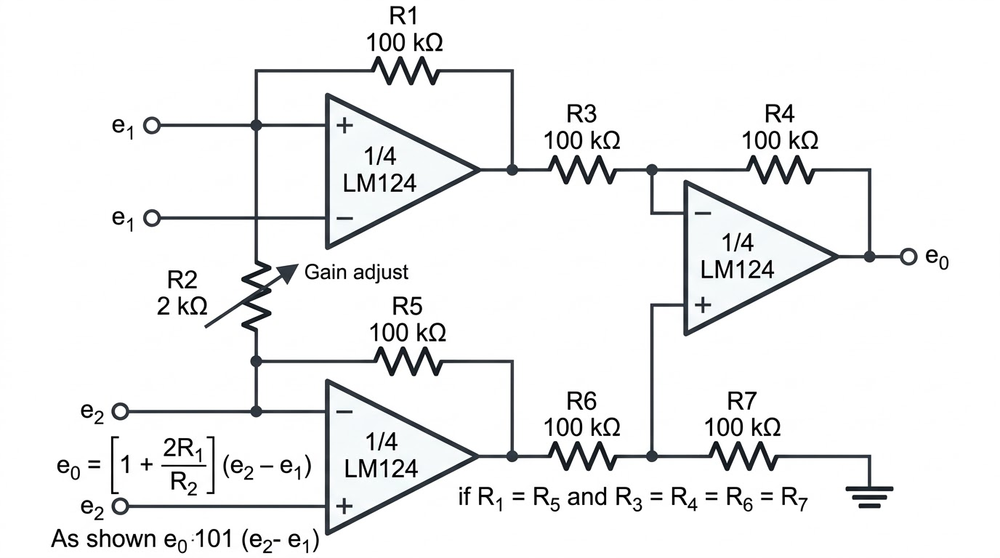

# High Input Impedance Adjustable Gain DC Instrumentation Amplifier

A project designing, simulating, and implementing a three-op-amp **High Input Impedance ($Z$) Adjustable Gain DC Instrumentation Amplifier**.

## Overview

An instrumentation amplifier is a precision differential amplifier typically constructed from three operational amplifiers: two non-inverting input buffer stages that provide very high input impedance and a third difference amplifier stage that rejects common-mode signals. By adjusting a single external potentiometer ($R_2$), the overall voltage gain can be tuned without disturbing the resistor matching of the differential stage.



## Circuit Design & Transfer Function

With matched resistors $R_1 = R_5 = 100\text{ k}\Omega$ and $R_3 = R_4 = R_6 = R_7 = 100\text{ k}\Omega$, the output voltage $e_o$ is governed by:

$$e_o = \left(1 + \frac{2R_1}{R_2}\right)(e_2 - e_1)$$

* **Op-Amp IC**: Quad operational amplifier (`LM124` / `LM324`)
* **Feedback & Differential Resistors**: $R_1 = R_3 = R_4 = R_5 = R_6 = R_7 = 100\text{ k}\Omega$
* **Gain Control**: Variable potentiometer $R_2$ (e.g., $R_2 = 2\text{ k}\Omega \Rightarrow \text{Gain} = 101$)

## Key Results & Implementation

* **Simulation (Proteus 8.0)**: The three-op-amp circuit was modeled using `LM324` op-amps and simulated in Proteus 8.0 with $R_2 = 10\text{ k}\Omega$, $e_1 = 2\text{ V}$, and $e_2 = 4\text{ V}$, measuring an output probe voltage of $V_o = 0.214348\text{ V}$.
* **Hardware PCB Prototype**: The circuit was fabricated on a custom PCB and tested with a 9V battery supply and an external breadboard-mounted potentiometer to verify adjustable output voltage control for general industrial and measurement applications.

## Repository Structure

```text
dc-instrumentation-amplifier/
├── README.md                                 # Project overview, circuit equations, and results
├── report.pdf                      # Full project report (theory, Proteus simulation, PCB photos)
├── schematic.png   # Illustrative 3-op-amp schematic diagram
└── .gitignore                                # Ignores temporary and OS files
```